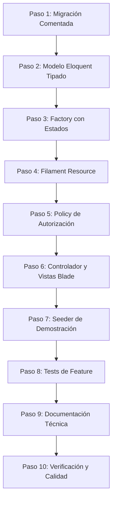

# Skill de Desarrollo de Módulos (Module Development)

*Última actualización: 2026-08-26*

Esta skill define el protocolo metódico y secuencial que cualquier agente de IA o desarrollador debe ejecutar al crear, refactorizar o extender módulos en **Skeleton Laravel Project**.

Sigue obligatoriamente los 10 pasos en estricto orden cronológico.

---

## Flujo de Trabajo Secuencial en 10 Pasos



---

### Paso 1: Migración (`database/migrations/`)
1. Generar la migración con nombre convencional: `YYYY_MM_DD_HHMMSS_create_[modulo]_table.php`.
2. **Comentarios 100% obligatorios**: Toda tabla debe incluir `$table->comment(...)` y cada columna debe tener su método descriptivo `->comment(...)` en español.
3. **Compatibilidad y tipos**:
   - Usar `jsonb` o `json` para campos traducibles (`title`, `content`, `excerpt`, `seo_*`).
   - Claves foráneas explícitas: `$table->foreignId('user_id')->constrained()->cascadeOnDelete();`.
   - Índices de rendimiento: para `slug` (único), pares compuestos `['status', 'is_active']`, `published_at`, `order`.
   - Integrar `softDeletes()` cuando corresponda.

```php
Schema::create('noticias', function (Blueprint $table) {
    $table->comment('Artículos de prensa y noticias corporativas');
    $table->id()->comment('Identificador único');
    $table->string('slug', 255)->unique()->comment('Slug URL amigable');
    $table->jsonb('title')->comment('Título traducible (es, en)');
    $table->jsonb('content')->nullable()->comment('Contenido enriquecido o bloques');
    $table->string('image', 512)->nullable()->comment('Imagen de cabecera en disco público');
    $table->string('status', 20)->default('draft')->comment('Estado: draft, published');
    $table->boolean('is_active')->default(true)->comment('Estado activo');
    $table->foreignId('user_id')->constrained('users')->cascadeOnDelete()->comment('Autor');
    $table->timestamp('published_at')->nullable()->comment('Fecha de publicación');
    $table->timestamps();
    $table->softDeletes()->comment('Borrado lógico');

    $table->index(['status', 'is_active'], 'idx_noticias_status_active');
});
```

---

### Paso 2: Modelo Eloquent Tipado (`app/Models/`)
1. **PHPDoc de clase exhaustivo**:
   - `@property` con tipos nativos para todas las columnas de la tabla.
   - `@property-read` para relaciones y accessors dinámicos.
   - `@method static Builder<Modelo> scopeName(...)` para cada scope local.
2. **Propiedades estándar**:
   - `$fillable`: Array estricto con los campos asignables en masa.
   - `$translatable`: Campos traducibles gestionados por `spatie/laravel-translatable`.
   - `casts()`: Método nativo de Laravel (`datetime`, backed enums, `boolean`, etc.).
3. **Accessors de multimedia**:
   - Implementar `getImageUrlAttribute(): ?string` resolviendo mediante `storage_image($this->image)` o `Storage::disk('public')->url($this->image)`.
4. **Tipado nativo estricto**:
   - Todos los métodos de relación deben declarar retorno exacto (`BelongsTo`, `HasMany`, `BelongsToMany`).
   - Scopes deben tipar `Builder $query` y devolver `: Builder`.

---

### Paso 3: Factory (`database/factories/`)
1. Crear la factory del modelo con soporte multiidioma (`'es' => ...`, `'en' => ...`).
2. Declarar estados fluidos reutilizables:
   - `published()`: `status => ContentStatus::Published`, `is_active => true`, `published_at => now()`.
   - `draft()`: `status => ContentStatus::Draft`, `published_at => null`.
   - `featured()`: `featured => true`.
   - `inactive()`: `is_active => false`.

```php
public function published(): static
{
    return $this->state(fn (array $attributes) => [
        'status' => ContentStatus::Published,
        'is_active' => true,
        'published_at' => now(),
    ]);
}
```

---

### Paso 4: Filament Resource (`app/Filament/Admin/Resources/`)
1. Modularizar componentes en subcarpetas del recurso:
   - `Pages/`: `ListNoticias.php`, `CreateNoticia.php`, `EditNoticia.php`.
   - `Schemas/` o bloques si el formulario es extenso.
2. **Subida de imágenes con editor**:
   - Usar `ImageCropField::make16x9()` para imágenes estándar (16:9), `ImageCropField::make8x12()` para verticales o `ImageCropField::make4x3()` para avatares.
   - Garantizar siempre `->imageEditor()`.
3. **Traducción integral**:
   - Todo label, columna, placeholder y grupo de navegación debe obtenerse con `__('filament.key')`.
   - Registrar las nuevas keys tanto en `lang/es/filament.php` como en `lang/en/filament.php`.
4. **Notificaciones nativas**:
   - Utilizar exclusivamente `Filament\Notifications\Notification::make()->success()->send()`.

---

### Paso 5: Policy de Autorización (`app/Policies/`)
1. Generar la policy para el modelo mapeando los roles del sistema (`App\Enums\Role` o roles de Filament Shield: `superadmin`, `admin`, `user`).
2. Restringir accesos:
   - `viewAny`, `view`: superadmin y admin.
   - `create`, `update`: superadmin y admin activos.
   - `delete`, `forceDelete`: solo superadmin.
3. Registrar la policy si es necesario en `AppServiceProvider` o mediante el auto-discovery estándar de Laravel.

---

### Paso 6: Controlador y Vistas Blade
1. **Controlador Web (`app/Http/Controllers/Web/`)**:
   - Consultas optimizadas con eager loading (`with(...)`).
   - Carga de SEO dinámico mediante `app(SeoService::class)->fromModel($model)`.
   - Respuestas 404 controladas si el contenido no está publicado ni activo (`abort(404)`).
2. **Vistas Blade (`resources/views/`)**:
   - Extender el layout principal `<x-app-layout>`.
   - **Prohibido maquetar botones o inputs con Tailwind manual**: Utilizar `<x-primary-button>`, `<x-text-input>`, etc.
   - Aplicar tokens semánticos de color Tailwind CSS v4 (`--color-dark`, `--color-surface`, `--color-primary`).
   - Enlace dinámico de imágenes: `{{ $model->image_url ?? asset('images/default.jpg') }}` con atributo `alt` descriptivo.
   - Textos bilingües con `__('messages.key')` o `$model->getTranslation('campo', app()->getLocale())`.

---

### Paso 7: Seeder de Demostración
1. Crear el seeder específico del módulo (`database/seeders/[Modelo]Seeder.php`).
2. Generar datos representativos en español e inglés utilizando `firstOrCreate` para asegurar idempotencia.
3. Registrar la llamada del seeder en `database/seeders/DatabaseSeeder.php` y en `database/seeders/DummyDataSeeder.php` / `ProjectDummy`.

---

### Paso 8: Tests Automatizados (`tests/Feature/`)
1. Crear la suite de pruebas del módulo: `tests/Feature/[Modulo]/[Modelo]Test.php`.
2. Validar como mínimo:
   - Acceso a la ruta pública `index` (código HTTP 200).
   - Detalle de elemento publicado (código HTTP 200) y elemento en borrador (código HTTP 404).
   - Autorización de acceso en el panel de administración según rol.
   - Operaciones CRUD básicas y validación de formularios.

---

### Paso 9: Documentación Técnica Obligatoria
1. Crear el archivo `docs/info/[modulo].md` utilizando la plantilla oficial [`docs/info/_MODULE_TEMPLATE.md`](file:///Users/fryntiz/git/skeleton-laravel-project/docs/info/_MODULE_TEMPLATE.md).
2. Cumplimentar los 7 apartados obligatorios.
3. Incluir la fecha `*Última actualización: YYYY-MM-DD*` en la cabecera.
4. Registrar el enlace en la tabla de `docs/info/README.md` y en la tabla de `AGENTS.md`.

---

### Paso 10: Verificación y Calidad de Código
Antes de dar por concluida la implementación del módulo, ejecutar en la terminal:
```bash
# 1. Formateo y estandarización PSR-12
vendor/bin/pint --format agent

# 2. Comprobación de que no hay fallos de linter
vendor/bin/pint --test --format agent

# 3. Ejecución de la suite completa de tests
php artisan test --compact
```
Solo cuando Pint reporte `passed` y todos los tests pasen al 100%, se considerará completado el módulo.
