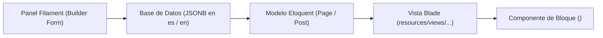

# Constructor Modular de Contenido (Content Builder)

*Última actualización: 2026-08-26*

> Especificación técnica sobre la arquitectura, almacenamiento JSON, catálogo de bloques y renderizado Blade del constructor modular de contenido para Páginas y Posts.

---

## 1. Resumen y Arquitectura

El **Constructor Modular de Contenido** permite componer páginas y publicaciones dinámicas mediante bloques flexibles e independientes en lugar de un único campo de texto plano. Proporciona a los redactores y administradores la libertad de maquetar artículos y landings corporativas combinando texto enriquecido, imágenes recortadas, vídeos, testimonios y botones de llamada a la acción (CTA).

### Flujo Arquitectónico



1. **Definición en Filament**: Se implementa mediante el componente nativo `Filament\Forms\Components\Builder` dentro de los esquemas de formulario en `PageResource` y `PostResource`.
2. **Almacenamiento**: Se serializa como un array de objetos con `type` y `data` dentro de la columna `jsonb` o `json` del modelo (`content`). Gracias a `spatie/laravel-translatable`, cada idioma (`es`, `en`) mantiene su propio array de bloques.
3. **Renderizado en Blade**: En las plantillas públicas (`resources/views/pages/show.blade.php` y `resources/views/posts/show.blade.php`), el array de bloques correspondiente al idioma activo se itera y delega en subcomponentes Blade limpios y reutilizables.

---

## 2. Estructura JSON en Base de Datos

En la base de datos PostgreSQL, la columna `content` almacena un objeto JSON por idioma con su lista secuencial de bloques:

```json
{
  "es": [
    {
      "type": "text",
      "data": {
        "content": "<p>Bienvenido a nuestra plataforma tecnológica líder en innovación.</p>"
      }
    },
    {
      "type": "image",
      "data": {
        "image": "pages/hero-transformacion.webp",
        "alt": "Equipo de ingenieros trabajando",
        "caption": "Centro de desarrollo de soluciones cloud"
      }
    },
    {
      "type": "cta",
      "data": {
        "title": "¿Listo para impulsar tu proyecto?",
        "description": "Agenda una consultoría técnica gratuita con nuestros especialistas.",
        "button_text": "Contactar ahora",
        "button_url": "/contact"
      }
    }
  ],
  "en": [
    {
      "type": "text",
      "data": {
        "content": "<p>Welcome to our technology platform leading digital transformation.</p>"
      }
    }
  ]
}
```

Cada elemento del array contiene:
- `type`: Cadena identificadora del tipo de bloque (`text`, `image`, `video`, `cta`, `quote`).
- `data`: Objeto clave-valor con los atributos propios del bloque.

---

## 3. Catálogo de Bloques Soportados

---

### 3.1. Bloque: Texto Enriquecido (`text`)

Diseñado para texto corporativo estructurado, párrafos, encabezados secundarios y listas.

#### Definición en Filament:
```php
use Filament\Forms\Components\Builder\Block;
use Filament\Forms\Components\RichEditor;

Block::make('text')
    ->label(__('filament.block_text'))
    ->icon('heroicon-o-document-text')
    ->schema([
        RichEditor::make('content')
            ->label(__('filament.content'))
            ->required()
            ->toolbarButtons([
                'bold', 'italic', 'underline', 'strike',
                'link', 'heading', 'bulletList', 'orderedList',
                'blockquote', 'codeBlock', 'undo', 'redo',
            ]),
    ]);
```

#### JSON en `data`:
```json
{
  "content": "<h2>Innovación continua</h2><p>Texto enriquecido con formato HTML seguro.</p>"
}
```

#### Renderizado en Blade:
```blade
<div class="prose prose-slate max-w-none text-dark leading-relaxed my-8">
    {!! $block['data']['content'] !!}
</div>
```

---

### 3.2. Bloque: Imagen con Cropper (`image`)

Permite insertar imágenes destacadas de ancho completo o centradas, con recorte obligatorio 16:9 y metadatos accesibles.

#### Definición en Filament:
```php
use Filament\Forms\Components\Builder\Block;
use Filament\Forms\Components\TextInput;
use App\Filament\Components\ImageCropField;

Block::make('image')
    ->label(__('filament.block_image'))
    ->icon('heroicon-o-photo')
    ->schema([
        ImageCropField::make16x9('image', 'content_builder', true, __('filament.image')),
        TextInput::make('alt')
            ->label(__('filament.image_alt'))
            ->placeholder('Descripción accesible de la imagen')
            ->required(),
        TextInput::make('caption')
            ->label(__('filament.image_caption'))
            ->nullable(),
    ]);
```

#### JSON en `data`:
```json
{
  "image": "content_builder/infraestructura.webp",
  "alt": "Servidores de alta disponibilidad",
  "caption": "Arquitectura distribuida en Kubernetes"
}
```

#### Renderizado en Blade:
```blade
<figure class="my-10">
    
    @if(!empty($block['data']['caption']))
        <figcaption class="mt-3 text-center text-sm text-muted">
            {{ $block['data']['caption'] }}
        </figcaption>
    @endif
</figure>
```

---

### 3.3. Bloque: Vídeo Embebido (`video`)

Permite incrustar vídeos de YouTube, Vimeo o URLs directas con marco adaptable 16:9.

#### Definición en Filament:
```php
use Filament\Forms\Components\Builder\Block;
use Filament\Forms\Components\TextInput;

Block::make('video')
    ->label(__('filament.block_video'))
    ->icon('heroicon-o-video-camera')
    ->schema([
        TextInput::make('url')
            ->label(__('filament.video_url'))
            ->url()
            ->required()
            ->placeholder('https://www.youtube.com/watch?v=...'),
        TextInput::make('caption')
            ->label(__('filament.caption'))
            ->nullable(),
    ]);
```

#### JSON en `data`:
```json
{
  "url": "https://www.youtube.com/embed/dQw4w9WgXcQ",
  "caption": "Demostración de la plataforma en vídeo"
}
```

#### Renderizado en Blade:
```blade
<div class="my-10">
    <div class="relative w-full aspect-video rounded-2xl overflow-hidden shadow-sm bg-dark">
        <iframe 
            src="{{ $block['data']['url'] }}" 
            class="absolute top-0 left-0 w-full h-full border-0" 
            allowfullscreen 
            loading="lazy"
        ></iframe>
    </div>
    @if(!empty($block['data']['caption']))
        <p class="mt-3 text-center text-sm text-muted">{{ $block['data']['caption'] }}</p>
    @endif
</div>
```

---

### 3.4. Bloque: Llamada a la Acción (`cta`)

Crea un módulo visual de conversión con fondo contrastado, título, descripción y botón normalizado.

#### Definición en Filament:
```php
use Filament\Forms\Components\Builder\Block;
use Filament\Forms\Components\TextInput;
use Filament\Forms\Components\Textarea;

Block::make('cta')
    ->label(__('filament.block_cta'))
    ->icon('heroicon-o-cursor-arrow-rays')
    ->schema([
        TextInput::make('title')
            ->label(__('filament.title'))
            ->required(),
        Textarea::make('description')
            ->label(__('filament.description'))
            ->rows(3)
            ->nullable(),
        TextInput::make('button_text')
            ->label(__('filament.button_text'))
            ->required(),
        TextInput::make('button_url')
            ->label(__('filament.button_url'))
            ->required(),
    ]);
```

#### JSON en `data`:
```json
{
  "title": "¿Comenzamos tu transformación digital?",
  "description": "Escríbenos y nuestro equipo te asesorará en cada etapa del desarrollo.",
  "button_text": "Hablar con un consultor",
  "button_url": "/contact"
}
```

#### Renderizado en Blade:
```blade
<section class="my-12 p-8 md:p-12 rounded-3xl bg-surface border border-gray-100 shadow-sm text-center">
    <h3 class="text-2xl md:text-3xl font-bold text-dark mb-4">
        {{ $block['data']['title'] }}
    </h3>
    @if(!empty($block['data']['description']))
        <p class="text-muted max-w-2xl mx-auto mb-8 text-base md:text-lg">
            {{ $block['data']['description'] }}
        </p>
    @endif
    <div class="inline-flex justify-center">
        <a href="{{ url($block['data']['button_url']) }}">
            <x-primary-button>
                {{ $block['data']['button_text'] }}
            </x-primary-button>
        </a>
    </div>
</section>
```

---

## 4. Guía para Añadir Nuevos Bloques

Para crear un nuevo bloque modular (por ejemplo, `faq` o `testimonial`):

1. **Registrar el Bloque en Filament**:
   Añade el método `Block::make('nombre_bloque')` con sus campos en el schema del Builder en `app/Filament/Admin/Resources/PageResource.php` y `PostResource.php`.
2. **Crear la Plantilla Blade del Bloque**:
   Crea la vista correspondiente en `resources/views/components/blocks/nombre_bloque.blade.php`.
3. **Mapear en el Renderizador Central**:
   En `resources/views/pages/show.blade.php` o en un iterador de bloques, incluye:
   ```blade
   @foreach($blocks as $block)
       @includeIf('components.blocks.' . $block['type'], ['data' => $block['data']])
   @endforeach
   ```
4. **Actualizar la Documentación**:
   Añade la especificación técnica del nuevo bloque en este documento (`docs/info/content_builder.md`).
